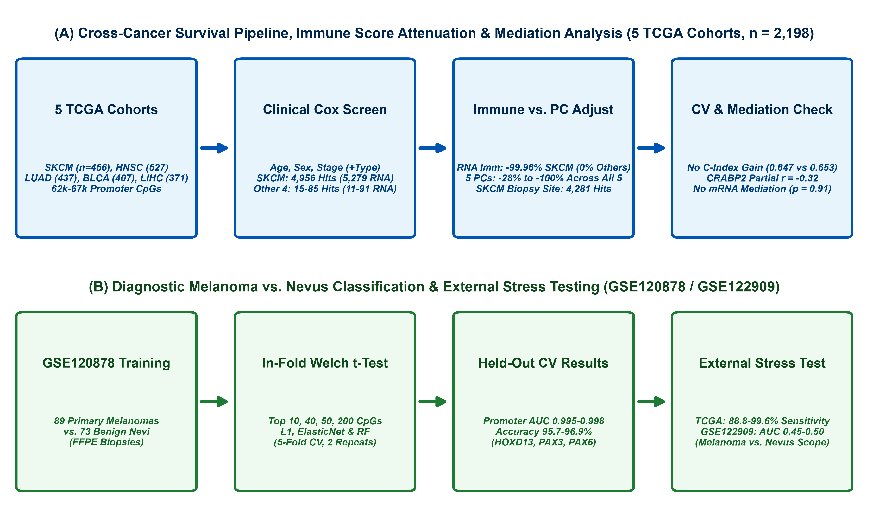
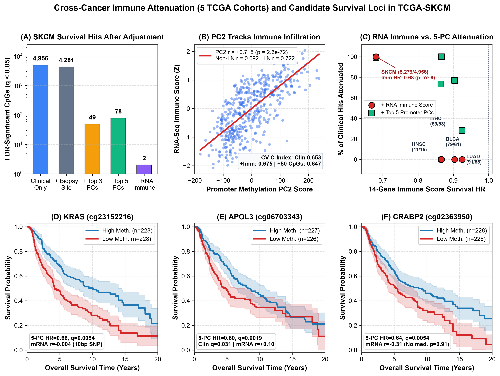
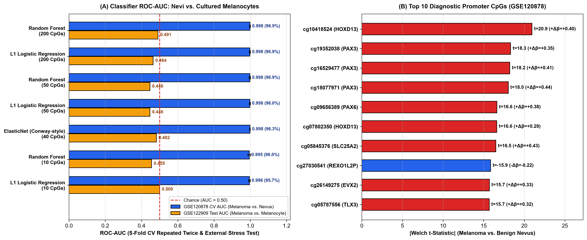

# Transcriptomic Immune Infiltration Confounds Bulk Promoter Methylation–Survival Screens in Cutaneous Melanoma but Not in Four Other Solid Cancers, with a Promoter Classifier Separating Melanoma from Benign Nevi

**Nolan Yu1, Valentina L. Kouznetsova1,2, Santosh Kesari3, and Igor F. Tsigelny1,2,4**

1Biana Institute, San Diego, CA, United States  
2San Diego Supercomputer Center, University of California, San Diego, La Jolla, CA, United States  
3Lundquist Institute, Torrance, CA, United States  
4Department of Neurosciences, University of California San Diego, La Jolla, CA, United States  

---

## Abstract

Bulk tumor DNA methylation arrays measure mixed malignant, immune, and stromal cells. Across five TCGA cohorts ($n = 2,198$: cutaneous melanoma [SKCM, $n = 456$], head and neck [HNSC, $n = 527$], lung [LUAD, $n = 437$], bladder [BLCA, $n = 407$], and liver [LIHC, $n = 371$]), we evaluated 62,060–67,102 promoter CpGs using clinical covariate-adjusted Cox models with Benjamini-Hochberg false discovery rate (FDR) control. Direct adjustment for a 14-gene RNA-seq immune infiltration score attenuated survival hits in melanoma—where immune infiltration strongly predicted survival ($n = 454$; $\text{HR} = 0.681, p = 6.99 \times 10^{-8}$), reducing clinical-only hits by 99.96% from 5,279 to 2 CpGs (*DYSFIP1* `cg03750525`, *KRAS* `cg23152216`)—whereas anatomic biopsy-site adjustment (lymph node vs. skin/visceral) left 4,281 of 4,956 full-cohort hits (13.6% attenuated). In HNSC, LIHC, BLCA, and LUAD ($\text{HR} = 0.865\text{–}0.925, p = 0.037\text{–}0.327$), RNA immune adjustment removed 0% of the small baseline hit sets (retaining 11, 59, 79, and 91 hits). By contrast, top 5 promoter principal components (PCs) captured broader global methylation and subtype variation, attenuating clinical-only hits across cohorts regardless of immune prognostic value (99.2% in SKCM, 73.3% in HNSC, 100% in LIHC, 77.0% in BLCA, 28.2% in LUAD). In SKCM, 5-PC hits were enriched for inverse mRNA correlations (36.4% vs. 23.2%, $p = 0.0090$), including three *CRABP2* promoter probes (`cg02363950` $r_{\text{partial}} = -0.321$), but *CRABP2* mRNA showed no evidence of mediating survival (bootstrap 95% CI: $-0.042$ to $+0.047$; Sobel $p = 0.908$) and multi-CpG models did not improve cross-validated C-index ($0.647$ vs. $0.653$). For diagnosis, promoter classifiers trained on GSE120878 ($n = 162$) achieved cross-validated AUC of 0.995–0.998 (88.8–99.6% SKCM sensitivity) but showed no discrimination between tissue melanomas and cultured melanocytes in GSE122909 ($n = 15$; AUC 0.45–0.50).

---

## Introduction

Cutaneous melanoma, arising from the malignant transformation of melanocytes, causes the majority of skin cancer deaths [1,2]. High mortality is linked to UV-induced mutational burden, metastasis, and therapy resistance [2,3]. Alongside somatic driver mutations (*BRAF*, *NRAS*, *NF1*) [2,4], epigenetic remodeling via DNA methylation—the covalent addition of a methyl group (–CH3) to the 5-carbon of cytosine in CpG dinucleotides by DNA methyltransferases (DNMT1, DNMT3A, DNMT3B), counterbalanced by TET dioxygenases—regulates promoter accessibility and gene silencing [5–8]. In solid tumors, focal promoter hypermethylation can silence tumor suppressors, while global hypomethylation tracks genomic instability [6–8].

However, bulk tumor methylation arrays in solid cancers measure a composite mixture of malignant cells, infiltrating leukocytes, and stroma [14]. In The Cancer Genome Atlas Skin Cutaneous Melanoma (TCGA-SKCM) cohort, lymphocyte infiltration and cytolytic activity are strongly associated with survival [4,6]. Clinical-only survival screens across bulk methylation arrays therefore risk confounding tumor-intrinsic methylation with leukocyte infiltration or anatomic biopsy site (such as lymph node versus cutaneous metastases). Similarly, in diagnostic modeling, Conway et al. [9] showed that a 40-CpG ElasticNet classifier in formalin-fixed, paraffin-embedded (FFPE) biopsies separates primary melanomas from benign nevi (GSE120878; validation ROC-AUC 0.996). Any classifier trained on nevi versus melanomas must nevertheless be stress-tested on independent melanocytic specimens—such as normal cultured melanocytes and tissue melanomas in GSE122909 [10]—to test whether its top features reflect malignancy-specific remodeling, culture-associated changes, or cohort differences.

Here, we analyzed 62,060–67,102 promoter CpGs across five TCGA solid cancer cohorts ($n = 2,198$ total: TCGA-SKCM, TCGA-HNSC, TCGA-LUAD, TCGA-BLCA, and TCGA-LIHC) using clinical covariate-adjusted Cox proportional hazards models [12] with Benjamini-Hochberg false discovery rate (FDR) control [13]. Focusing on TCGA-SKCM ($n = 456$; 454 with RNA-seq) and comparing across all five cohorts, we characterized the correlates of the top promoter methylation principal components (PCs), compared direct 14-gene transcriptomic immune-score adjustment against 5-PC adjustment, evaluated permutation-based FDR calibration, tested anatomic biopsy-site adjustment in melanoma, tested $\text{CpG} \times \text{immune-score}$ interactions across a 50/50 discovery/validation split, tested genome-wide enrichment of survival CpGs for inverse mRNA correlations, and tested via nonparametric bootstrap and Sobel mediation [24] whether *CRABP2* mRNA mediates the survival association of *CRABP2* promoter methylation. Finally, we trained promoter classifiers on GSE120878 [9] with in-fold feature selection and evaluated their sensitivity in TCGA-SKCM and boundary conditions in GSE122909 [10].

---

## Methods

### Data Sources

Illumina HumanMethylation450 ($\beta$-value) arrays, clinical annotations, survival follow-up, and level-3 RNA-seq gene expression (`HiSeqV2`, $\log_2(\text{RSEM}+1)$) for TCGA-SKCM (475 methylation; 474 RNA-seq samples), head and neck squamous cell carcinoma (TCGA-HNSC), lung adenocarcinoma (TCGA-LUAD), bladder urothelial carcinoma (TCGA-BLCA), and liver hepatocellular carcinoma (TCGA-LIHC) were obtained from the Genomic Data Commons (GDC) and TCGA hubs on UCSC Xena [4,17]. Diagnostic training data comprised GSE120878 (89 primary invasive FFPE melanomas and 73 benign nevi; Conway et al. [9]). GSE122909 (Fujiwara et al. [10]) was held out strictly for external stress testing; series metadata confirm 19 samples: 7 tissue melanomas (5 primary [PM1, PN2, PM3, PM5, PM6], 2 metastatic [MM4, MM5]), 8 normal cultured melanocyte samples (5 patient-derived cultures from 4 melanoma donors [N1, N1-2, N2, N3, N4] plus 3 commercial normal human epidermal melanocyte [NHEM] lines [CN1, CN2, CN3]), and 4 melanoma cell lines (SK-MEL-28, G361, DEOC-1, HM2KO). Promoter annotations (TSS200/TSS1500), coordinates, and polymorphism flags (`Probe_SNPs`, `Probe_SNPs_10`) were obtained from the Illumina GPL13534 manifest [11,15,16].

### Prognostic Survival, Immune Composition, Biopsy Site, and Cross-Cancer Generalization

Across all five TCGA cohorts, we retained tumor samples (`01A`/`01B` primary; `06A`/`06B`/`07A` metastatic), excluded all solid-tissue normal samples (`11A`/`11B`; $n = 2$ in SKCM, $n = 50$ in HNSC, $n = 32$ in LUAD, $n = 21$ in BLCA, $n = 50$ in LIHC), required positive overall survival time and non-missing age, and deduplicated multiple aliquots to one sample per patient (preferring primary tumors). This yielded 456 patients in TCGA-SKCM (99 primary, 357 metastatic; 221 deaths; 454 with RNA-seq), 527 in TCGA-HNSC (527 primary; 224 deaths; 519 with RNA-seq), 437 in TCGA-LUAD (437 primary; 158 deaths; 433 with RNA-seq), 407 in TCGA-BLCA (407 primary; 180 deaths; 402 with RNA-seq), and 371 in TCGA-LIHC (371 primary; 133 deaths; 365 with RNA-seq). Baseline clinical covariates in all five cohorts comprised standardized age, sex, and AJCC pathologic stage (I, II, III, IV, unknown; plus stage 0 and primary vs. metastatic status in TCGA-SKCM, the only cohort containing metastases). To test anatomic resection site in TCGA-SKCM, we extracted `site_of_resection_or_biopsy.diagnoses` (available for all 456/456 patients) and categorized biopsies into lymph node ($n = 209$: 208 metastatic, 1 primary), skin/cutaneous ($n = 141$: 90 primary, 51 metastatic), subcutaneous/soft tissue ($n = 71$: 65 metastatic, 6 primary), and visceral/other sites ($n = 35$: 33 metastatic, 2 primary). Among the 139,996 promoter probes (TSS200/TSS1500) in GPL13534, we retained CpGs in each cohort with $\le 20\%$ missing values and pre-imputation $\text{SD}(\beta) > 0.05$, yielding 67,102 tested promoter CpGs in SKCM, 64,044 in HNSC, 62,060 in LUAD, 63,201 in BLCA, and 64,673 in LIHC. Remaining missing values were mean-imputed and each CpG was standardized to zero mean and unit variance.

Each CpG was tested using a covariate-adjusted Cox score test (Breslow ties) [12], with null parameters estimated via BFGS optimization (`scipy.optimize.minimize`) [18,19] and multivariable candidate and mediation models fitted via `statsmodels` (`PHReg`) [22]. Across all tested probes, $p$-values were adjusted via the Benjamini-Hochberg procedure ($q$-values) [13]. Re-fitting the top 15 clinical hits in SKCM with exact Efron ties gave near-identical results (e.g., *KRAS* `cg23152216` Breslow $p = 1.47 \times 10^{-10}$ vs. Efron $p = 2.5 \times 10^{-10}$). In SKCM, we also evaluated a Cox model stratified by primary vs. metastatic status, a model adjusted for anatomic biopsy site (`Clinical + Biopsy Site`), proportional-hazards checks via $\text{CpG} \times \log(\text{time})$, and a SNP-free screen removing all 9,679 promoter probes carrying an Illumina `Probe_SNPs` ($n = 7,214$) or `Probe_SNPs_10` ($n = 2,872$) flag (leaving 57,423 probes).

To summarize bulk tumor variation in an outcome-independent manner, we computed principal components (PCs) of the standardized promoter methylation matrix (`scikit-learn` `PCA` [21]) in each cohort and correlated PC1–5 against global mean promoter methylation, clinical covariates, and transcriptomic immune infiltration. From matched `HiSeqV2` RNA-seq profiles, we computed a standardized 14-gene immune infiltration score averaging $Z$-scores of canonical pan-leukocyte, T-cell, cytolytic, and antigen-presentation markers (*PTPRC*/CD45, *CD8A*, *CD8B*, *CD3D*, *CD3E*, *GZMA*, *PRF1*, *IFNG*, *CXCL9*, *CXCL10*, *STAT1*, *PSMB9*, *TAP1*, *HLA-DRA*), and verified a 12-gene score excluding *PSMB9*/*TAP1* and a 6-gene T-cell/cytolytic score (*CD8A*, *CD8B*, *CD3D*, *CD3E*, *GZMA*, *PRF1*) in SKCM. In each cohort, we repeated the Cox screen adjusting for clinical covariates plus the top 3 PCs or top 5 PCs (on each full methylation cohort), or the 14-gene RNA-seq immune score (on each RNA-matched subset, compared against the clinical-only screen on the identical RNA-matched patients). To evaluate empirical FDR calibration across all five cohorts and four models, we ran 50 survival-time permutations per model holding covariates and methylation fixed (recording the nominal $p < 0.05$ fraction, the fraction of permutations with $\ge 1$ hit at $q < 0.05$, and median/mean $q < 0.05$ false positives). In SKCM ($n = 454$), we partitioned patients *a priori* into a 50/50 discovery ($n = 227$, 110 deaths) and validation ($n = 227$, 110 deaths) split stratified by death status to test median-split immune subgroups and $\text{CpG} \times \text{immune-score}$ interactions.

### Genome-Wide Regulator Enrichment, Mediation, and Concordance Evaluation

In TCGA-SKCM, we mapped 65,227 of the 67,102 promoter CpGs to expressed genes in `HiSeqV2` RNA-seq ($n = 454$) and computed unadjusted, immune-adjusted partial, and 5-PC-adjusted partial Pearson correlations ($r$) with matched mRNA expression. Enrichment for inverse immune-adjusted correlations ($r_{\text{partial}} < -0.20, q < 0.05$) among survival-linked CpGs was tested against the 65,227-probe background (Fisher's exact test) and 1,000 random CpG sets matched on joint deciles of probe $\text{SD}(\beta)$ and mean $\beta$. For *CRABP2* (`cg02363950`), we tested whether *CRABP2* mRNA predicts survival in Cox models (`PHReg`) and evaluated the indirect pathway ($\text{methylation} \to \text{mRNA} \to \text{survival}$) via the Sobel test [24] and 1,000-resample nonparametric bootstrap percentile 95% CIs on $a \times b$. Five-fold stratified cross-validation was used to test whether adding the top 50, 100, or 200 5-PC-adjusted CpGs (selected within each training fold) improves held-out Harrell's C-index.

### Diagnostic Classifier Training and External Stress Testing

In GSE120878 ($n = 162$), we removed probes with $\ge 5\%$ missing values, mean-imputed remaining sporadic missing entries, and evaluated L1-penalized logistic regression ($C = 1.0$), random forests (200 trees), and a 40-CpG ElasticNet logistic regression model (`l1_ratio = 0.5`, $C = 1.0$) across five-fold stratified cross-validation repeated twice using `scikit-learn` [21]. Within each training fold, features were ranked by Welch's $t$-statistic between melanomas and nevi to select the top $k \in \{10, 40, 50, 200\}$ CpGs. We compared promoter-only models against models drawing from the 60,000 highest-variance array probes, and verified that in-fold variance filtering gave identical cross-validated performance ($\Delta\text{AUC} < 0.001$). Final promoter-only models trained on all 162 GSE120878 samples were applied without retuning to TCGA-SKCM ($n = 456$) and to the 15 non-cell-line samples in GSE122909 (7 tissue melanomas vs. 8 cultured melanocytes, with 2,000-resample stratified bootstrap 95% CIs on ROC-AUC; the 4 melanoma cell lines were analyzed separately). Analyses used Python with `numpy` [18], `scipy` [19], `pandas` [20], `scikit-learn` [21], `statsmodels` [22], and `matplotlib` [23].

---

## Results

### Study Design, Analytical Funnel, and Attenuation of Clinical-Only Survival Associations

The study design and analytical funnel are summarized in Figure 1 and Table 1. When adjusted only for clinical covariates in TCGA-SKCM (age, sex, stage, and primary vs. metastatic status), 15,264 of 67,102 promoter CpGs had $p < 0.05$ (~3,355 expected under the null) and 4,956 reached $q < 0.05$, of which 4,153 (83.8%) had $\text{HR} < 1$ per SD increase in methylation and 803 had $\text{HR} > 1$ (Table 1). A model stratified by primary vs. metastatic status yielded similar counts (15,367 at $p < 0.05$; 4,680 at $q < 0.05$), and removing all 9,679 probes with manifest `Probe_SNPs` or `Probe_SNPs_10` flags prior to FDR correction yielded 4,211 clinical-only hits at $q < 0.05$ across 57,423 SNP-free promoter CpGs. In the unfiltered clinical-only screen, the lowest $p$-value occurred at `cg23152216` in *KRAS* ($\text{HR} = 0.640, p = 1.47 \times 10^{-10}, q = 9.89 \times 10^{-6}$).

Characterization of the top five promoter methylation PCs alongside matched TCGA-SKCM RNA-seq data ($n = 454$) revealed distinct sources of bulk variation (Figure 2B). **PC1** (13.4% of variance) tracked **global mean promoter methylation** ($r = +0.978, p = 1.6 \times 10^{-312}$) and correlated modestly with age ($r = +0.150, p = 0.0013$), but not with the 14-gene RNA-seq immune score ($r = -0.040, p = 0.39$) or sample type ($r = +0.025, p = 0.60$). By contrast, **PC2** (9.8% of variance) correlated strongly with the 14-gene transcriptomic immune score ($r = +0.715, p = 2.58 \times 10^{-72}$; $r = +0.729$ with cytolytic *GZMA*/*PRF1*; $r = +0.703$ with pan-leukocyte *PTPRC*/CD45). **PC3** (5.6% of variance) correlated modestly with the immune score ($r = -0.224, p = 1.48 \times 10^{-6}$) and metastatic status ($r = +0.125, p = 0.0074$), **PC4** (3.1%) correlated with primary vs. metastatic status ($r = +0.242, p = 1.79 \times 10^{-7}$), and **PC5** (2.5%) tracked sex via X/Y-linked probes ($r = -0.910$). Together, PC1–3 explained 56.2% of the variance in the 14-gene immune score (multiple $R = 0.750, R^2 = 0.562$). Excluding *PSMB9* and *TAP1* from the immune score yielded a slightly stronger correlation with PC2 (12-gene score: $r = +0.725, p = 3.24 \times 10^{-75}$; PC1–3 $R = 0.759$), as did a 6-gene T-cell/cytolytic score (PC2 $r = +0.758, p = 7.93 \times 10^{-86}$). In clinical-adjusted Cox models, PC2 ($p = 0.001$), PC3 ($p = 0.003$), and the RNA-seq immune score itself ($\text{HR} = 0.681$ per SD, $p = 6.99 \times 10^{-8}$ in $n = 454$) were each associated with survival, whereas PC1 was not ($p = 0.14$).

**Fig. 1 Bioinformatic pipeline for cross-cancer survival modeling with immune vs. PC adjustment and diagnostic classification.** (A) Prognostic branch across five TCGA cohorts ($n = 2,198$; TCGA-SKCM $n = 456$, 454 RNA-matched), showing promoter probe filtering (62,060–67,102 CpGs; 57,423 SNP-free in SKCM), clinical Cox screening (4,956 full / 5,279 RNA-matched hits in SKCM; 15–85 full / 11–91 RNA-matched hits in HNSC, LUAD, BLCA, and LIHC at $q < 0.05$), direct RNA immune adjustment (99.96% attenuated in SKCM vs. 0% in other four) vs. 5-PC adjustment (28.2–100% attenuated across all five) and SKCM biopsy-site adjustment (4,281 hits), and C-index / *CRABP2* mediation checks. (B) Diagnostic branch trained on GSE120878 (89 melanomas vs. 73 nevi) and externally tested on TCGA-SKCM and GSE122909.

Adjusting the SKCM Cox screen for the first three promoter PCs attenuated FDR-significant loci from 4,956 to 49 CpGs at $q < 0.05$ (31 shared with clinical-only hits; 99.4% attenuated); including five PCs left 78 CpGs at $q < 0.05$ (42 shared; 99.2% attenuated; 48 and 78 CpGs when SNP-flagged probes were excluded before screening) (Figure 2A). Adjusting directly for the 14-gene RNA-seq immune score ($n = 454$) attenuated the 5,279 clinical-only hits in the RNA-matched cohort by 99.96% to **2 CpGs at $q < 0.05$**: `cg03750525` (*DYSFIP1*; $\text{HR} = 0.710, p = 4.80 \times 10^{-7}, q = 0.0216$) and `cg23152216` (*KRAS*; $\text{HR} = 0.710, p = 6.45 \times 10^{-7}, q = 0.0216$), followed by `cg25053164` (*LOC286094*; $\text{HR} = 0.703, p = 4.62 \times 10^{-6}, q = 0.103$).

**Table 1 Step-by-step data reduction and analytical funnel for prognostic and diagnostic analyses**

| Analytical Stage | Unit | Count | Filtering Criteria / Summary |
| :--- | :---: | :---: | :--- |
| Total TCGA-SKCM Array Profiles | Samples | 475 | UCSC Xena GDC release (Illumina 450K) |
| Final Deduplicated SKCM Cohort | Patients | 456 | Tumor samples (`01A`/`06A`/`06B`/`07A`; 2 `11A` normals excluded), 1 per patient (99 primary, 357 metastatic; 221 deaths; 454 with RNA-seq) |
| Total Promoter CpGs on Array | CpG Sites | 139,996 | Annotated to TSS200 or TSS1500 in GPL13534 |
| Tested Promoter CpGs (TCGA-SKCM) | CpG Sites | 67,102 | $\le 20\%$ missing values and pre-imputation $\text{SD}(\beta) > 0.05$ (57,423 without manifest SNPs) |
| Clinical-Adjusted Survival Hits ($p < 0.05$) | CpG Sites | 15,264 | Adjusted for age, sex, AJCC stage, and primary vs. metastatic (~3,355 expected by chance) |
| Clinical-Adjusted Survival Hits ($q < 0.05$) | CpG Sites | 4,956 | Benjamini-Hochberg FDR $< 0.05$ (4,153 protective; 803 hazardous); RNA-matched ($n = 454$): 5,279; SNP-free: 4,211 |
| Biopsy-Site-Adjusted Hits (Clinical + Site) | CpG Sites | 4,281 | FDR $q < 0.05$ after adjusting for anatomic resection site (lymph node, skin, soft tissue, visceral; 13.6% attenuated) |
| Composition-Adjusted Hits (Clinical + 3 PCs) | CpG Sites | 49 | FDR $q < 0.05$ after adjusting for top 3 promoter PCs (1 at $q < 0.01$; SNP-free: 48; 99.4% of clinical hits attenuated) |
| Composition-Adjusted Hits (Clinical + 5 PCs) | CpG Sites | 78 | FDR $q < 0.05$ after adjusting for top 5 promoter PCs (7 at $q < 0.01$; SNP-free: 78; 99.2% of clinical hits attenuated) |
| Immune-Adjusted Hits (Clinical + RNA Immune) | CpG Sites | 2 | FDR $q < 0.05$ after adjusting for 14-gene RNA-seq immune score ($n = 454$; 2/5,279 retained; 99.96% attenuated) |
| Cross-Cancer Cohorts (HNSC/LUAD/BLCA/LIHC) | Patients | 1,742 | HNSC ($n = 527$), LUAD ($n = 437$), BLCA ($n = 407$), LIHC ($n = 371$); 62,060–64,673 promoter CpGs |
| Diagnostic Training & Stress-Test Sets | Samples | 162 / 15 | GSE120878 (89 melanomas, 73 nevi) and GSE122909 (7 tissue melanomas, 8 cultured melanocytes; plus 4 cell lines) |

Because 209 of the 456 TCGA-SKCM tumors (and 208 of 357 metastases) were resected from lymph nodes—an intrinsically lymphoid-rich compartment—we tested whether anatomic biopsy site (lymph node [$n = 209$], skin [$n = 141$], soft tissue [$n = 71$], visceral [$n = 35$]) explained the immune signal. Lymph node biopsy status correlated modestly with the RNA-seq immune score ($r = +0.249, p = 7.29 \times 10^{-8}$; mean immune $Z = +0.271$ in lymph node vs. $-0.283$ in skin, $-0.124$ in soft tissue, $-0.227$ in visceral sites) and with PC2 ($r = +0.192, p = 3.85 \times 10^{-5}$). However, PC2 strongly tracked the RNA-seq immune score **both within non-lymph-node tumors** ($n = 246$: $r = +0.692, p = 1.87 \times 10^{-36}$) and **within lymph node biopsies** ($n = 208$: $r = +0.722, p = 9.84 \times 10^{-35}$). Moreover, adjusting the clinical Cox screen for biopsy site (`Clinical + Biopsy Site`, $n = 456$) left **4,281 FDR-significant CpGs at $q < 0.05$** (14,613 at $p < 0.05$; attenuating only 13.6% of the 4,956 clinical-only hits; Figure 2A), and the RNA-seq immune score remained strongly prognostic after biopsy-site adjustment ($\text{HR} = 0.673, p = 8.85 \times 10^{-8}$). Adding 5 PCs or the RNA immune score on top of `Clinical + Biopsy Site` again collapsed significant hits from 4,281 to **115 CpGs** and **2 CpGs**. Thus, continuous variation in leukocyte infiltration within each anatomic compartment—rather than categorical biopsy site alone—is consistent with the bulk survival signal.

### Cross-Cancer Generalization, Immune vs. PC Adjustment, Permutation Calibration, and Concordance

To test whether immune-associated survival attenuation extends beyond melanoma, we ran the identical pipeline across four additional TCGA cohorts of primary solid tumors (`01A`/`01B` after removing `11A`/`11B` normals): head and neck (TCGA-HNSC, $n = 527$, 224 deaths; 64,044 CpGs), lung adenocarcinoma (TCGA-LUAD, $n = 437$, 158 deaths; 62,060 CpGs), bladder (TCGA-BLCA, $n = 407$, 180 deaths; 63,201 CpGs), and liver (TCGA-LIHC, $n = 371$, 133 deaths; 64,673 CpGs) (Table 3, Figure 2C).

Across all five cancers examined, the top three promoter methylation PCs tracked both global mean promoter methylation ($r = +0.850$ to $+0.982$) and the 14-gene RNA-seq immune score (PC1–3 multiple $R = 0.750$ in SKCM, $0.607$ in HNSC [PC1–5 $R = 0.691$], $0.728$ in LUAD, $0.732$ in BLCA, and $0.574$ in LIHC [PC1–5 $R = 0.639$]; all $p < 10^{-16}$; Table 3). However, comparing direct RNA-seq immune-score adjustment against 5-PC adjustment revealed a key distinction (Table 3, Figure 2C). Because the top five promoter PCs capture broader variation—including global methylation, tumor purity, sex, and molecular subtype—**5-PC adjustment is not specific to prognostic immune infiltration**: it attenuated 99.2% of clinical-only hits in SKCM (retaining 42/4,956), 73.3% in HNSC (4/15), 100.0% in LIHC (0/83), 77.0% in BLCA (14/61), and 28.2% in LUAD (61/85). By contrast, **the contrast between melanoma and the four other cohorts rests on direct RNA-seq immune-score adjustment alone**, and in the four non-melanoma cohorts the baseline clinical-only denominators in the RNA-matched subsets are small (11 in HNSC, 59 in LIHC, 79 in BLCA, and 91 in LUAD, vs. 5,279 in SKCM; Table 3). In TCGA-SKCM, where the 14-gene immune score was strongly protective ($\text{HR} = 0.681, p = 6.99 \times 10^{-8}$), direct RNA immune adjustment attenuated 99.96% of clinical-only hits (retaining 2/5,279 CpGs). In HNSC ($\text{HR} = 0.865, p = 0.0367$), LIHC ($\text{HR} = 0.866, p = 0.118$), BLCA ($\text{HR} = 0.904, p = 0.189$), and LUAD ($\text{HR} = 0.925, p = 0.327$), where the immune score was not strongly prognostic, RNA immune adjustment attenuated 0% of the baseline clinical-only hits (retaining 11/11, 59/59, 79/79, and 91/91; Figure 2C). Across 50 survival-time permutations (`OS.time`, `OS`) per model and cohort with covariates and methylation fixed, **nominal $p$-values were near-calibrated (mean 5.18–6.51% at $p < 0.05$; median 0–3 hits at $q < 0.05$), but $q$-values were anti-conservative because of correlated probe blocks, with 28–78% of permutations (14/50 to 39/50; vs. ~5% expected under independent tests) yielding at least one false discovery at $q < 0.05$** and mean false-positive counts of 0.76–48.2 across adjusted models (e.g., 4.08–20.06 in LIHC and 1.92–15.56 in LUAD; Table 3). Because the non-melanoma baseline counts (11, 59, 79, and 91 hits) are comparable in size to these null false-positive means, the 0% attenuation (100% retention) in those four cohorts is not informative on its own and may reflect noise-level baseline hit sets, further underscoring that the cross-cancer contrast rests on melanoma. Conversely, the large post-adjustment count increases in several models—such as LIHC rising from 59 to 559 and BLCA from 79 to 401 under RNA immune adjustment, or HNSC from 15 to 772 and LUAD from 85 to 695 under 3-PC adjustment—far exceed the permutation null means and likely reflect real covariate-conditioned signal (whether from variance reduction or statistical suppression) rather than null FDR inflation.

**Fig. 2 Immune and PC attenuation, transcriptomic validation, 5-cancer comparison, and candidate survival curves.** (A) Log-scale bar chart of promoter CpGs in TCGA-SKCM ($n = 456$) at $q < 0.05$ after clinical (4,956), biopsy-site (4,281), 3-PC (49), 5-PC (78), or RNA immune (2 in $n = 454$) adjustment. (B) Promoter methylation PC2 vs. RNA-seq immune score in TCGA-SKCM ($n = 454$; $r = +0.715, p = 2.6 \times 10^{-72}$; non-LN $r = +0.692$, LN $r = +0.722$) and 5-fold CV C-index. (C) Percentage of clinical-only hits attenuated by RNA immune adjustment (red circles; 99.96% in SKCM vs. 0% in other four) vs. 5-PC adjustment (green squares; 28.2–100% across all five) plotted against immune score survival HR (labels: RNA-matched / full-cohort baseline clinical hits). (D–F) Median-split Kaplan-Meier curves (95% CIs) in TCGA-SKCM for *KRAS* (`cg23152216`), *APOL3* (`cg06703343`), and *CRABP2* (`cg02363950`).

To test whether promoter CpGs predict survival differently in immune-hot vs. immune-cold melanomas, we evaluated $\text{CpG} \times \text{immune-score}$ interactions and median-split subgroups across our pre-specified 50/50 discovery ($n = 227$, 110 deaths) and validation ($n = 227$, 110 deaths) split in TCGA-SKCM. Across all 67,102 promoter CpGs, **0 CpGs reached $q < 0.05$ for a $\text{CpG} \times \text{immune-score}$ interaction** in the discovery half ($\min p = 6.88 \times 10^{-6}$), validation half ($\min p = 3.18 \times 10^{-6}$), or full cohort ($\min p = 1.36 \times 10^{-5}$), and only 1 of 356 nominal discovery interaction candidates ($p < 10^{-3}$) was concordant at $p < 0.05$ in validation (~8.9 expected by chance; 0 at validation FDR $< 0.05$). Subgroup screens in immune-cold ($n = 227$) and immune-hot ($n = 227$) tumors similarly yielded 0 hits at $q < 0.05$ in the full cohort and 0 replicated hits at validation FDR $< 0.05$, with *CRABP2* (`cg02363950`) showing comparable hazard ratios in immune-cold ($\text{HR} = 0.802, p = 0.0054$) and immune-hot ($\text{HR} = 0.704, p = 0.0068$) tumors (interaction $p = 0.489$). In five-fold cross-validation in TCGA-SKCM, the clinical-only Cox model achieved a held-out C-index of $0.653 \pm 0.056$, and adding the 14-gene RNA-seq immune score yielded $0.675 \pm 0.036$ ($\Delta\text{C} = +0.022$, 95% CI: $-0.028$ to $+0.072$). Adding the top 50, 100, or 200 composition-adjusted promoter CpGs did not improve held-out concordance over clinical covariates alone (top 50 CpGs: C-index $0.647 \pm 0.039$, $\Delta\text{C} = -0.006$, 95% CI: $-0.042$ to $+0.030$) or over clinical covariates plus the RNA immune score (C-index $0.670 \pm 0.021$, $\Delta\text{C} = -0.005$, 95% CI: $-0.025$ to $+0.016$; Figure 2B).

**Table 3 Cross-cancer comparison of promoter methylation PCA, RNA-seq immune infiltration, and survival screening across five TCGA cohorts ($n = 2,198$)**

| Metric | TCGA-SKCM (Melanoma) | TCGA-HNSC (Head & Neck) | TCGA-LUAD (Lung Adenocarc.) | TCGA-BLCA (Bladder) | TCGA-LIHC (Liver) |
| :--- | :---: | :---: | :---: | :---: | :---: |
| Patients: Fulla / Deaths / RNAb | 456 / 221 / 454 | 527 / 224 / 519 | 437 / 158 / 433 | 407 / 180 / 402 | 371 / 133 / 365 |
| Primary / Metastatic Tumorsa | 99 / 357 | 527 / 0 | 437 / 0 | 407 / 0 | 371 / 0 |
| Tested Promoter CpGsa | 67,102 | 64,044 | 62,060 | 63,201 | 64,673 |
| PC1 $r$ with Mean Promoter $\beta$a | $+0.978$ (13.4%) | $+0.960$ (17.1%) | $+0.982$ (12.4%) | $+0.850$ (14.7%) | $+0.933$ (16.1%) |
| Strongest Immune PC ($r$, $p$)b | PC2: $+0.715$ ($2.6 \times 10^{-72}$) | PC1: $+0.487$ ($3.2 \times 10^{-32}$) | PC2: $+0.552$ ($7.9 \times 10^{-36}$) | PC1: $+0.648$ ($3.5 \times 10^{-49}$) | PC3: $+0.421$ ($4.3 \times 10^{-17}$) |
| PC1–3 Multiple $R$ ($R^2$) Immuneb | 0.750 (56.2%) | 0.607 (36.8%) | 0.728 (53.0%) | 0.732 (53.5%) | 0.574 (33.0%) |
| RNA Immune Score $\to$ OS (HR, $p$)b | $0.681$ ($6.99 \times 10^{-8}$) | $0.865$ ($0.0367$) | $0.925$ ($0.327$) | $0.904$ ($0.189$) | $0.866$ ($0.118$) |
| Clinical-Only Hits: Fulla / RNAb | 4,956 / 5,279 | 15 / 11 | 85 / 91 | 61 / 79 | 83 / 59 |
| Clinical + 3 PCs Hits (Ret./Fulla)c | 49 (31/4,956) | 772 (15/15) | 695 (85/85) | 130 (45/61) | 53 (17/83) |
| Clinical + 5 PCs Hits (Ret./Fulla; % Att.)c | 78 (42; 99.2%) | 4 (4; 73.3%) | 241 (61; 28.2%) | 71 (14; 77.0%) | 0 (0; 100.0%) |
| Clinical + RNA Imm. (Ret./RNAb; % Att.)c | 2 (2/5,279; 99.96%) | 71 (11/11; 0%) | 198 (91/91; 0%) | 401 (79/79; 0%) | 559 (59/59; 0%) |
| Perm. Null % $\ge 1$ Hit (Med.; Mean)c | 56–68% (1–2; 4.6–12.1) | 28–46% (0; 0.8–1.7) | 40–48% (0; 1.9–15.6) | 48–60% (0–2; 4.9–48.2) | 64–78% (1–3; 4.1–20.1) |
| *CRABP2* (`cg02363950`) vs. mRNAb | $-0.314$ ($7.7 \times 10^{-12}$) | $-0.214$ ($8.6 \times 10^{-7}$) | $-0.188$ ($8.3 \times 10^{-5}$) | $-0.286$ ($5.5 \times 10^{-9}$) | $+0.085$ ($0.104$) |

a**Full methylation cohort** ($n = 456, 527, 437, 407, 371$): used for `Clinical + 3 PCs` and `Clinical + 5 PCs` screens; baseline clinical-only $q < 0.05$ denominators are 4,956 (SKCM; 15,264 at $p < 0.05$), 15 (HNSC; 7,049 at $p < 0.05$), 85 (LUAD; 5,395 at $p < 0.05$), 61 (BLCA; 6,787 at $p < 0.05$), and 83 (LIHC; 5,894 at $p < 0.05$). b**RNA-seq–matched subset** ($n = 454, 519, 433, 402, 365$): used for immune correlations, `RNA Immune Score -> OS`, and `Clinical + RNA Immune` screens; re-running the clinical-only Cox screen on this exact subset yields 5,279 (SKCM), 11 (HNSC), 91 (LUAD), 79 (BLCA), and 59 (LIHC) baseline hits at $q < 0.05$, which serve as the denominators for RNA immune-adjusted retention. c**Permutation calibration** (50 survival-time permutations per model and cohort with covariates and methylation fixed): nominal $p$-values were near-calibrated (5.18–6.51% at $p < 0.05$), but $q$-values were anti-conservative because of correlated probe blocks, with 28–78% of permutations yielding $\ge 1$ false discovery at $q < 0.05$ (vs. ~5% expected under independent tests; median 0–3, mean 0.76–48.2 across adjusted models; 105.0 in clinical-only SKCM).

### Candidate Loci, Regulator Enrichment, and *CRABP2* Mediation Analysis

Table 2 lists the top 12 promoter CpGs in TCGA-SKCM ranked by 5-PC-adjusted $p$-value alongside the immune-adjusted survivor *DYSFIP1* (`cg03750525`, 5-PC $q = 0.0322$) and the pilot locus *ZCCHC11* (`cg00754357`; clinical $q = 7.15 \times 10^{-4}$; 5-PC $q = 0.0741$). Across all 65,227 promoter CpGs mapped to expressed genes in TCGA-SKCM `HiSeqV2` RNA-seq ($n = 454$), 39.5% (25,787 probes) had a negative immune-adjusted partial correlation ($r_{\text{partial}} < 0, q < 0.05$) and **23.2% (15,126 probes)** had a moderate-to-strong inverse correlation ($r_{\text{partial}} < -0.20, q < 0.05$; mean $r_{\text{partial}} = -0.079$). Among the 77 mapped 5-PC-adjusted survival hits ($q < 0.05$), **36.4% (28/77)** exhibited $r_{\text{partial}} < -0.20, q < 0.05$, enriched over both the full array background ($\text{OR} = 1.89$, Fisher's exact $p = 0.0096$) and 1,000 random CpG sets matched on probe $\text{SD}(\beta)$ and mean $\beta$ deciles (matched null mean 23.7%, 95% interval 14.3–33.8%, empirical $p = 0.0090$). Those 28 inverse-correlated 5-PC hits included **three *CRABP2* promoter probes** (`cg02363950` $r_{\text{partial}} = -0.321$; `cg24251193` $r_{\text{partial}} = -0.257$; `cg17165580` $r_{\text{partial}} = -0.239$) and five *SERPINE2* promoter probes ($r_{\text{partial}} = -0.238$ to $-0.326$). Similarly, the 226 mapped nominal hits ($p < 10^{-3}$) from the RNA-seq immune-adjusted Cox screen were enriched for inverse mRNA correlations (34.1% [77/226], $\text{OR} = 1.72$, Fisher $p = 1.93 \times 10^{-4}$, matched-null $p = 0.0010$).

Among individual candidates (Table 2), ***CRABP2* (`cg02363950`)** showed a consistent negative correlation with *CRABP2* mRNA before ($r = -0.314, p = 7.72 \times 10^{-12}$; Spearman $\rho = -0.307$) and after adjusting for the RNA-seq immune score ($r_{\text{partial}} = -0.321, p = 2.63 \times 10^{-12}$) or PC1–5 ($r_{\text{partial}} = -0.227, p = 9.73 \times 10^{-7}$), carried no manifest SNP flags, and replicated its negative mRNA correlation in TCGA-HNSC ($r = -0.214$), TCGA-LUAD ($r = -0.188$), and TCGA-BLCA ($r = -0.286$), though not in TCGA-LIHC ($r = +0.085, p = 0.104$; Table 3). By contrast, neither of the two loci surviving FDR $< 0.05$ after direct RNA-seq immune adjustment correlated with its bulk mRNA: ***DYSFIP1* (`cg03750525`)** showed $r = +0.024$ ($p = 0.608$; immune-adjusted $r_{\text{partial}} = +0.040$) and ***KRAS* (`cg23152216`)** showed $r = -0.004$ ($p = 0.940$; immune-adjusted $r_{\text{partial}} = -0.033$; 10-bp SNP flag `rs61759611`; Table 2). *APOL3*, *IGFL4*, *GABRB3*, and *CX3CR1* displayed positive methylation–expression correlations ($r_{\text{partial}} = +0.155$ to $+0.285$). In proportional-hazards checks ($\text{CpG} \times \log(\text{time})$), *CRABP2* ($p = 0.32$), *LOC286094* ($p = 0.12$), *CPA6* ($p = 0.095$), *APOL3* `cg15245051` ($p = 0.39$), *GABRB3* ($p = 0.093$), and *CX3CR1* ($p = 0.70$) showed no evidence of non-proportional hazards, whereas *KRAS*, *PDE2A*, and *ZCCHC11* showed late follow-up attenuation ($> 10$ years; Figure 2D).

Because *CRABP2* (`cg02363950`) was the strongest composition-adjusted candidate with an immune-independent inverse mRNA correlation, we tested whether *CRABP2* mRNA expression itself predicts survival and mediates the `cg02363950` survival association ($n = 454$). Although higher *CRABP2* mRNA showed a weak trend toward higher hazard ($\text{HR} > 1$), ***CRABP2* mRNA expression did not significantly predict overall survival** in clinical-only ($\text{HR} = 1.11$ per SD, 95% CI: 0.96–1.29, $p = 0.149$), clinical-plus-immune ($\text{HR} = 1.11$, 95% CI: 0.95–1.28, $p = 0.185$), or clinical-plus-5-PC ($\text{HR} = 1.15$, 95% CI: 0.97–1.36, $p = 0.107$) Cox models. In joint Cox models containing both `cg02363950` methylation and *CRABP2* mRNA, `cg02363950` retained its survival association without attenuation: in the clinical-plus-immune model, $\text{HR} = 0.772$ ($p = 2.14 \times 10^{-4}$) vs. $0.774$ ($p = 9.16 \times 10^{-5}$) alone, with indirect effect $a \times b = +0.0025$ (1,000-resample bootstrap 95% CI: $-0.0418$ to $+0.0471$; Sobel $z = +0.115, p = 0.908$); in the clinical-plus-5-PC model, $\text{HR} = 0.673$ ($p = 1.29 \times 10^{-6}$) vs. $0.666$ ($p = 5.00 \times 10^{-7}$) alone, with $a \times b = -0.0111$ (bootstrap 95% CI: $-0.0423$ to $+0.0141$; Sobel $z = -0.861, p = 0.389$); and in the clinical-only model, $a \times b = -0.0064$ (bootstrap 95% CI: $-0.0510$ to $+0.0358$; Sobel $p = 0.762$). Thus, while the Sobel test is low-powered, both nonparametric bootstrap CIs and negligible HR attenuation indicate no evidence that bulk steady-state *CRABP2* mRNA mediates the survival association of `cg02363950`.

**Table 2 Leading candidate promoter CpG sites associated with overall survival in TCGA-SKCM ($n = 456$) and matched mRNA correlations ($n = 454$)**

| # | Probe ID | Gene | Clin HR | Clin *p* | Clin *q* | 5-PC HR | 5-PC *p* | 5-PC *q* (No-SNP *q*) | mRNA *r* (*p*) | Imm-Adj *r* (*p*) |
| :-: | :--- | :--- | :---: | :---: | :---: | :---: | :---: | :---: | :---: | :---: |
| 1 | `cg06703343` | *APOL3* | 0.80 | $1.59 \times 10^{-3}$ | 0.0312 | 0.60 | $2.84 \times 10^{-8}$ | 0.0019 (0.0016) | $+0.095$ (0.043) | $+0.171$ ($2.5 \times 10^{-4}$) |
| 2 | `cg25053164` | *LOC286094* | 0.69 | $6.19 \times 10^{-6}$ | 0.0024 | 0.64 | $1.94 \times 10^{-7}$ | 0.0054 (0.0056) | $+0.019$ (0.689) | $+0.023$ (0.631) |
| 3 | `cg02363950` | *CRABP2* | 0.79 | $4.59 \times 10^{-4}$ | 0.0159 | 0.64 | $2.92 \times 10^{-7}$ | 0.0054 (0.0056) | $-0.314$ ($7.7 \times 10^{-12}$) | $-0.321$ ($2.6 \times 10^{-12}$) |
| 4 | `cg23152216`a | *KRAS* | 0.64 | $1.47 \times 10^{-10}$ | $9.89 \times 10^{-6}$ | 0.66 | $3.22 \times 10^{-7}$ | 0.0054 (Excl. SNP) | $-0.004$ (0.940) | $-0.033$ (0.490) |
| 5 | `cg21860285` | *CPA6* | 0.78 | $3.48 \times 10^{-4}$ | 0.0136 | 0.63 | $7.45 \times 10^{-7}$ | 0.0084 (0.0083) | $+0.094$ (0.045) | $+0.017$ (0.718) |
| 6 | `cg14790396` | *PDE2A* | 0.77 | $2.21 \times 10^{-5}$ | 0.0038 | 0.67 | $8.42 \times 10^{-7}$ | 0.0084 (0.0083) | $+0.079$ (0.094) | $+0.067$ (0.156) |
| 7 | `cg05664072` | *PER2* | 0.76 | $1.84 \times 10^{-5}$ | 0.0035 | 0.62 | $8.72 \times 10^{-7}$ | 0.0084 (0.0083) | $-0.060$ (0.201) | $-0.060$ (0.199) |
| 8 | `cg13095627` | *IGFL4* | 0.66 | $1.06 \times 10^{-8}$ | 0.0002 | 0.71 | $1.51 \times 10^{-6}$ | 0.0124 (0.0120) | $+0.225$ ($1.2 \times 10^{-6}$) | $+0.230$ ($7.7 \times 10^{-7}$) |
| 9 | `cg15245051` | *APOL3* | 0.83 | $6.74 \times 10^{-3}$ | 0.0710 | 0.66 | $1.67 \times 10^{-6}$ | 0.0124 (0.0120) | $+0.139$ (0.003) | $+0.285$ ($6.4 \times 10^{-10}$) |
| 10 | `cg14222314` | *GABRB3* | 1.23 | $1.58 \times 10^{-3}$ | 0.0311 | 1.44 | $1.97 \times 10^{-6}$ | 0.0132 (0.0126) | $+0.246$ ($1.0 \times 10^{-7}$) | $+0.262$ ($1.5 \times 10^{-8}$) |
| 11 | `cg24130739` | *CX3CR1* | 0.81 | $2.57 \times 10^{-3}$ | 0.0407 | 0.66 | $2.37 \times 10^{-6}$ | 0.0144 (0.0136) | $+0.199$ ($1.9 \times 10^{-5}$) | $+0.155$ ($9.0 \times 10^{-4}$) |
| 12 | `cg17720013` | *IGFL4* | 0.69 | $4.29 \times 10^{-7}$ | 0.0009 | 0.71 | $3.07 \times 10^{-6}$ | 0.0158 (0.0146) | $+0.228$ ($9.2 \times 10^{-7}$) | $+0.228$ ($8.7 \times 10^{-7}$) |
| — | `cg03750525`b | *DYSFIP1* | 0.69 | $1.13 \times 10^{-7}$ | 0.0005 | 0.71 | $2.22 \times 10^{-5}$ | 0.0322 (0.0322) | $+0.024$ (0.608) | $+0.040$ (0.396) |
| — | `cg00754357` | *ZCCHC11* | 0.70 | $2.03 \times 10^{-7}$ | 0.0007 | 0.73 | $1.91 \times 10^{-4}$ | 0.0741 (0.0751) | $-0.098$ (0.038) | $-0.129$ (0.0059) |

a`cg23152216` (*KRAS*) carries an Illumina manifest `Probe_SNPs_10` flag (`rs61759611`); none of the other 13 probes carry `Probe_SNPs` or `Probe_SNPs_10` flags. b`cg03750525` (*DYSFIP1*) is one of two CpGs (with `cg23152216`) reaching $q < 0.05$ after direct RNA-seq immune-score adjustment ($q = 0.0216$).

### Melanoma Versus Nevus Classification in GSE120878 and External Stress Testing

In GSE120878 (89 primary FFPE melanomas and 73 benign nevi), classifiers using in-fold Welch $t$-statistic feature selection achieved held-out ROC-AUC between 0.992 and 0.998 across five-fold cross-validation repeated twice (Table 4, Figure 3). Promoter-only models performed at least as well as models using the 60,000 highest-variance array probes: 10-CpG L1 logistic regression reached an AUC of $0.996 \pm 0.005$ (accuracy $95.7\% \pm 2.1\%$), 50- and 200-CpG random forests reached $0.998 \pm 0.003\text{–}0.004$ (accuracy $96.9\% \pm 2.4\text{–}2.8\%$), and a 40-CpG ElasticNet (`l1_ratio = 0.5`) promoter model achieved $0.998 \pm 0.002$ (accuracy $96.3\% \pm 1.9\%$, sensitivity 95.5%, specificity 97.2%), comparable to the split-sample validation of Conway et al. [9] (AUC 0.996). The top 10 differentially methylated promoter probes ranked by $|\text{Welch } t|$ lay in developmental homeobox and paired-box transcription factors—*HOXD13* (`cg10418524`, $t = +20.95, \Delta\beta = +0.399$; `cg07802350`, $t = +16.61, \Delta\beta = +0.289$), *PAX3* (`cg19352038`, $t = +18.32, \Delta\beta = +0.349$; `cg16529477`, $t = +18.22, \Delta\beta = +0.410$; `cg18077971`, $t = +18.03, \Delta\beta = +0.437$), *PAX6* (`cg09656389`, $t = +16.63, \Delta\beta = +0.376$), *EVX2* (`cg26149275`, $t = +15.70, \Delta\beta = +0.334$), and *TLX3* (`cg05787556`, $t = +15.68, \Delta\beta = +0.319$)—plus *SLC25A2* (`cg05845376`, $t = +16.49, \Delta\beta = +0.435$) and *REXO1L2P* (`cg27030541`, $t = -15.85, \Delta\beta = -0.223$), with nine of 10 hypermethylated in melanoma (Figure 3B, Table 4).

**Table 4 Diagnostic classifier performance in GSE120878 (5-fold cross-validation repeated twice) and external testing on TCGA-SKCM and GSE122909**

| Probe Set | *k* | Classifier Model | GSE120878 CV AUC | GSE120878 CV Acc (%) | TCGA-SKCM Sens: All / Prim / Met (%) | GSE122909 Test AUC (95% CI) |
| :--- | :-: | :--- | :---: | :---: | :---: | :---: |
| Promoter-Only | 10 | L1 Logistic Regression | $0.996 \pm 0.005$ | $95.7\% \pm 2.1\%$ | 88.8% / 96.0% / 86.8% | 0.500 (0.20–0.80) |
| Promoter-Only | 10 | Random Forest | $0.995 \pm 0.008$ | $96.0\% \pm 2.4\%$ | 93.0% / 98.0% / 91.6% | 0.455 (0.18–0.75) |
| Promoter-Only | 40 | ElasticNet (Conway-style) | $0.998 \pm 0.002$ | $96.3\% \pm 1.9\%$ | 99.3% / 99.0% / 99.4% | 0.482 (0.18–0.79) |
| Promoter-Only | 50 | L1 Logistic Regression | $0.998 \pm 0.003$ | $96.0\% \pm 3.1\%$ | 98.0% / 99.0% / 97.8% | 0.446 (0.16–0.75) |
| Promoter-Only | 50 | Random Forest | $0.998 \pm 0.004$ | $96.9\% \pm 2.4\%$ | 98.9% / 99.0% / 98.9% | 0.446 (0.13–0.77) |
| Promoter-Only | 200 | L1 Logistic Regression | $0.998 \pm 0.003$ | $96.9\% \pm 3.1\%$ | 99.6% / 100.0% / 99.4% | 0.464 (0.16–0.77) |
| Promoter-Only | 200 | Random Forest | $0.998 \pm 0.003$ | $96.9\% \pm 2.8\%$ | 99.6% / 100.0% / 99.4% | 0.491 (0.18–0.79) |
| All-Probes (60k) | 10 | L1 Logistic Regression | $0.993 \pm 0.008$ | $95.7\% \pm 3.1\%$ | — | — |
| All-Probes (60k) | 10 | Random Forest | $0.993 \pm 0.009$ | $95.7\% \pm 3.7\%$ | — | — |
| All-Probes (60k) | 50 | L1 Logistic Regression | $0.992 \pm 0.006$ | $95.1\% \pm 2.0\%$ | — | — |
| All-Probes (60k) | 50 | Random Forest | $0.997 \pm 0.004$ | $96.9\% \pm 2.4\%$ | — | — |
| All-Probes (60k) | 200 | L1 Logistic Regression | $0.996 \pm 0.007$ | $95.7\% \pm 2.5\%$ | — | — |
| All-Probes (60k) | 200 | Random Forest | $0.998 \pm 0.003$ | $97.8\% \pm 2.4\%$ | — | — |

Note: Across the 9 hypermethylated top-10 diagnostic probes (*HOXD13*, *PAX3*, *PAX6*, *SLC25A2*, *EVX2*, *TLX3*), cross-cohort mean $\beta$-values were 0.236 in GSE120878 nevi ($n = 73$), 0.608 in GSE120878 melanomas ($n = 89$), 0.650 in TCGA-SKCM ($n = 456$), 0.460 in GSE122909 tissue melanomas ($n = 7$), 0.476 in GSE122909 cultured melanocytes ($n = 8$), and 0.462 in GSE122909 melanoma cell lines ($n = 4$).

When promoter-only classifiers trained on GSE120878 were applied to TCGA-SKCM ($n = 456$), sensitivity ranged from 88.8% (96.0% primary, 86.8% metastatic) for 10-CpG L1 logistic regression up to 98.0–99.6% (99.0–100.0% primary, 97.8–99.4% metastatic) for 40-, 50-, and 200-CpG models (Table 4). By contrast, when stress-tested on GSE122909 ($n = 15$: 7 tissue melanomas vs. 8 cultured melanocyte samples; Fujiwara et al. [10]), test ROC-AUC ranged from 0.446 to 0.500 (95% bootstrap CIs: 0.13–0.80; Table 4, Figure 3A), showing no discrimination between tissue melanomas and cultured melanocytes (with 4 of 8 cultured melanocyte samples classified as melanoma). Cross-cohort comparison of the nine hypermethylated diagnostic probes (Table 4 note) showed low methylation in GSE120878 benign nevi ($\bar{\beta} = 0.236$) and high methylation in GSE120878 melanomas ($\bar{\beta} = 0.608$) and TCGA-SKCM melanomas ($\bar{\beta} = 0.650$), whereas GSE122909 tissue melanomas ($\bar{\beta} = 0.460$), cultured normal melanocytes ($\bar{\beta} = 0.476$), and melanoma cell lines ($\bar{\beta} = 0.462$) all showed intermediate methylation. Across 13,243 common high-variance promoter CpGs, 1,191 probes (8.99%) met $|\Delta\beta| > 0.20, p < 0.01$ in GSE120878 and 10 probes (0.08%) met those thresholds in GSE122909 ($n = 15$), yielding a single concordant probe (`cg25864024` in *FAM174B*) vs. ~0.45 expected by chance.

**Fig. 3 Diagnostic cross-validation performance, external stress test, and top promoter features.** (A) ROC-AUC on a full 0.0–1.0 scale comparing held-out 5-fold cross-validation performance (repeated twice) in GSE120878 (melanoma vs. benign nevus; blue bars, AUC 0.995–0.998) against external stress-test performance in GSE122909 (tissue melanoma vs. cultured melanocytes; orange bars, AUC 0.446–0.500) for L1-penalized logistic regression, ElasticNet, and random forest classifiers using $k \in \{10, 40, 50, 200\}$ promoter CpGs. (B) Top 10 promoter CpGs ranked by absolute Welch $t$-statistic in GSE120878 (red: hypermethylated in melanoma; blue: hypomethylated in melanoma).

---

## Discussion

### Attenuation of Bulk Methylation-Survival Signals and Five-Cancer Comparison

A central finding of our study is that the survival signal spanning 4,956 promoter CpGs in clinical-only Cox models of TCGA-SKCM is strongly attenuated when adjusting for promoter methylation PCs (leaving 49 and 78 CpGs with 3 and 5 PCs; 99.4% and 99.2% of clinical-only hits attenuated) or for a matched RNA-seq immune infiltration score (leaving 2 CpGs at $q < 0.05$; 99.96% attenuated). Addressing the competing hypothesis that this signal reflects lymph node vs. cutaneous biopsy site in TCGA-SKCM, we found that PC2 tracks the 14-gene RNA-seq immune score strongly within both non-lymph-node tumors ($r = +0.692$) and lymph node biopsies ($r = +0.722$), and that adjusting for categorical biopsy site leaves 4,281 FDR-significant CpGs (attenuating only 13.6%), whereas adding PCs or the RNA immune score on top of biopsy site collapses hits to 115 and 2 CpGs.

Applying the identical pipeline across five TCGA cohorts—TCGA-SKCM ($n = 456$), TCGA-HNSC ($n = 527$), TCGA-LUAD ($n = 437$), TCGA-BLCA ($n = 407$), and TCGA-LIHC ($n = 371$)—highlighted a critical distinction between unsupervised methylation PC adjustment and direct RNA-seq immune-score adjustment (Table 3, Figure 2C). In all five cancers examined, the top three promoter PCs tracked both global mean promoter methylation ($r = +0.850$ to $+0.982$) and the 14-gene immune score (PC1–3 multiple $R = 0.574\text{–}0.750$). However, 5-PC adjustment attenuated clinical-only survival hits not only in melanoma (99.2% removed), where the immune score is strongly prognostic ($\text{HR} = 0.681, p = 6.99 \times 10^{-8}$), but also in HNSC (73.3% removed), LIHC (100.0% removed), BLCA (77.0% removed), and LUAD (28.2% removed), where the immune score is weakly or non-significantly associated with survival ($\text{HR} = 0.865\text{–}0.925, p = 0.037\text{–}0.327$). Thus, PC-based attenuation is not specific to prognostic immune infiltration; top methylation PCs capture broader variation (global methylation, purity, sex, and subtype). Rather, the contrast between melanoma and the four other cohorts rests specifically on direct RNA-seq immune-score adjustment, which removed 99.96% of clinical-only hits in RNA-matched SKCM (5,277/5,279) vs. 0.0% in HNSC, LUAD, BLCA, and LIHC (11, 91, 79, and 59 retained hits; Table 3). Moreover, our 50 survival-time permutations per model and cohort showed that **nominal $p$-values were near-calibrated (mean 5.18–6.51% at $p < 0.05$; median 0–3 hits at $q < 0.05$), but $q$-values were anti-conservative because of correlated probe blocks, with 28–78% of permutations yielding at least one false discovery at $q < 0.05$** and mean false-positive counts of 0.76–48.2 across adjusted models (e.g., 4.08–20.06 in LIHC; 1.92–15.56 in LUAD). Because the non-melanoma baseline counts (11–91 hits) are similar in magnitude to these null false-positive means, the 0% attenuation (100% retention) in those four cohorts is not informative on its own and may reflect noise-level baseline hit sets, reinforcing that the contrast rests on melanoma. At the same time, the large post-adjustment count increases in several models (such as LIHC rising from 59 to 559 and BLCA from 79 to 401 under RNA immune adjustment, or HNSC from 15 to 772 under 3-PC adjustment) far exceed the permutation null means and are likely real covariate-conditioned signals—whether from variance reduction or statistical suppression—rather than permutation-level FDR noise. Finally, across a 50/50 discovery/validation split in TCGA-SKCM, we found no FDR-significant $\text{CpG} \times \text{immune-score}$ interactions and no improvement in out-of-sample C-index from adding top promoter CpGs ($\Delta\text{C} = -0.006$ and $-0.005$).

### Regulator Enrichment and Mechanistic Evaluation of *CRABP2* Using Matched RNA-Seq

Across all 65,227 mRNA-mapped promoter CpGs in TCGA-SKCM, composition-adjusted survival candidates were enriched for inverse methylation–expression correlations ($r_{\text{partial}} < -0.20, q < 0.05$) relative to both the array background (36.4% of 5-PC hits [28/77] and 34.1% of nominal $p < 10^{-3}$ immune-adjusted hits [77/226] vs. 23.2% background; OR 1.89 and 1.72) and SD- and mean-$\beta$-matched nulls ($p = 0.0090$ and $p = 0.0010$). Among these candidates, *CRABP2* was supported by three promoter probes (`cg02363950` $r_{\text{partial}} = -0.321$, `cg24251193` $r_{\text{partial}} = -0.257$, `cg17165580` $r_{\text{partial}} = -0.239$), and `cg02363950` replicated its negative mRNA correlation in TCGA-HNSC ($r = -0.214$), TCGA-LUAD ($r = -0.188$), and TCGA-BLCA ($r = -0.286$). Nevertheless, mediation analysis in TCGA-SKCM revealed that bulk *CRABP2* mRNA expression does not significantly predict survival ($\text{HR} = 1.11, p = 0.185$ after clinical and immune adjustment) and showed no evidence of mediating the survival association of `cg02363950` (bootstrap 95% CI for $a \times b$: $-0.0418$ to $+0.0471$; Sobel $p = 0.908$ [24]). Likewise, neither of the two loci surviving FDR $< 0.05$ after direct RNA immune adjustment—*DYSFIP1* (`cg03750525`, $r_{\text{partial}} = +0.040$) and *KRAS* (`cg23152216`, $r_{\text{partial}} = -0.033$; 10-bp SNP flag `rs61759611`)—correlated with its bulk mRNA, indicating that bulk CpG survival associations can reflect cell-state covariates rather than mediation by steady-state transcript abundance.

### Stress-Testing Melanoma Methylation Classifiers Across Sample Types

In GSE120878, promoter-only classifiers achieved five-fold cross-validated discrimination (AUC 0.995–0.998; accuracy 95.7–96.9%) comparable to Conway et al. [9] (AUC 0.996) and detected 88.8–99.6% of TCGA-SKCM tumors (Table 4, Figure 3). However, external stress testing on GSE122909 [10] ($n = 15$: 7 tissue melanomas vs. 8 cultured melanocytes) yielded no discrimination (AUC 0.446–0.500; 95% CIs: 0.13–0.80). Cross-cohort inspection of $\beta$-values (Table 4 note) shows that the top diagnostic developmental transcription factor promoters (*HOXD13*, *PAX3*, *PAX6*, *EVX2*, *TLX3*) are unmethylated in benign nevi *in vivo* ($\bar{\beta} = 0.236$) and hypermethylated in GSE120878 FFPE melanomas ($\bar{\beta} = 0.608$) and TCGA-SKCM melanomas ($\bar{\beta} = 0.650$), but show intermediate methylation in GSE122909 cultured melanocytes ($\bar{\beta} = 0.476$), tissue melanomas ($\bar{\beta} = 0.460$), and cell lines ($\bar{\beta} = 0.462$), consistent with culture- or proliferation-associated remodeling at developmental homeobox loci [5,7] and specimen differences.

### Study Limitations

1. **Single Positive Cohort, Non-Informative Non-Melanoma Retention, and PC Non-Specificity:** Among the five TCGA cohorts examined, only TCGA-SKCM exhibited a strong prognostic immune effect and large baseline clinical-only survival inflation; moreover, TCGA-SKCM consists predominantly of metastases (357/456 metastases, 48.5% mortality), whereas HNSC, LUAD, BLCA, and LIHC consist of primary tumors (`01A`/`01B` after removing `11A`/`11B` normals; 35.8–44.2% mortality). Because 5-PC adjustment removes 28.2–100.0% of baseline hits across all five cancers, the contrast between melanoma and the four other cohorts relies on direct RNA-seq immune-score adjustment alone, where the non-melanoma baseline counts (11, 59, 79, and 91 hits) are comparable to null false-positive means so that 0% attenuation in those four cohorts is not informative on its own.
2. **Residual Within-Site Lymphoid Confounding and Marker Score:** Although categorical biopsy-site adjustment in TCGA-SKCM left 4,281 hits and PC2 tracked immune expression within both lymph node ($r = +0.722$) and non-lymph-node ($r = +0.692$) biopsies, categorical site adjustment cannot eliminate continuous differences in normal lymphoid content among lymph node metastases. Also, our 14-gene immune score is a marker average rather than a calibrated deconvolution estimator such as CIBERSORT [25] or ESTIMATE [26].
3. **Anti-Conservative $q$-Values Under Correlated Probes, Cohort-Level PCA, and Statistical Power:** In survival-time permutations, nominal $p$-values were near-calibrated (5.18–6.51% at $p < 0.05$), but $q$-values were anti-conservative because of correlated probe blocks, with 28–78% of permutations yielding $\ge 1$ false discovery at $q < 0.05$ (mean 0.76–48.2 false positives across adjusted models; post-adjustment increases such as 59 to 559 in LIHC nevertheless far exceed these null means). Mean imputation and PCA were performed on each full cohort matrix before survival modeling (though C-index feature selection was strictly in-fold), and our 50/50 split ($n = 227$ per half) for $\text{CpG} \times \text{immune}$ interactions and Sobel/bootstrap mediation tests have limited power for small effects.
4. **Manifest-Based SNP Filtering and GSE122909 Sample Size:** Our polymorphism check removed the 9,679 promoter probes flagged in GPL13534 (`Probe_SNPs`, `Probe_SNPs_10`) rather than external cross-reactive lists [15,16], and GSE122909 contains 15 non-cell-line samples (7 tissue melanomas and 8 cultured melanocytes) comparing fresh/cultured specimens against FFPE biopsies in GSE120878.

---

## Conclusion

Across five TCGA cohorts ($n = 2,198$ across SKCM, HNSC, LUAD, BLCA, and LIHC), top promoter methylation PCs tracked global promoter methylation ($r = +0.850\text{–}0.982$) and transcriptomic immune infiltration ($R = 0.574\text{–}0.750$) in all five cancers examined. Whereas 5-PC adjustment attenuated 28.2–100.0% of clinical-only hits across all five cohorts, direct adjustment for the 14-gene RNA-seq immune score attenuated 99.96% of clinical-only hits in melanoma (5,277/5,279 in RNA-matched SKCM, where immune infiltration strongly predicts survival; $\text{HR} = 0.681, p = 6.99 \times 10^{-8}$; biopsy-site adjustment left 4,281 hits) compared with 0.0% of the smaller clinical-only hit sets (11–91 hits) in HNSC, LIHC, BLCA, and LUAD, consistent with the hypothesis that immune admixture inflates bulk survival screens specifically when leukocyte infiltration is strongly prognostic. Although 5-PC-adjusted hits in melanoma were enriched for inverse mRNA correlations (36.4% vs. 23.2%, $p = 0.0090$), led by three *CRABP2* promoter probes (`cg02363950` $r_{\text{partial}} = -0.321$), *CRABP2* mRNA showed no evidence of mediating survival (bootstrap 95% CI: $-0.042$ to $+0.047$; Sobel $p = 0.908$) and multi-CpG models did not improve held-out C-index. In parallel, a 10- to 200-CpG promoter classifier separated primary melanoma from benign nevi (AUC 0.995–0.998; 88.8–99.6% TCGA-SKCM sensitivity) but showed no discrimination between tissue melanomas and cultured melanocytes in GSE122909 (AUC 0.45–0.50).

---

## Data and Code Availability

TCGA-SKCM, TCGA-HNSC, TCGA-LUAD, TCGA-BLCA, and TCGA-LIHC data were obtained from UCSC Xena (`https://xenabrowser.net/datapages/`), and GSE120878, GSE122909, and GPL13534 from NCBI GEO (`https://www.ncbi.nlm.nih.gov/geo/`). All Python scripts and output tables (using `numpy` [18], `scipy` [19], `pandas` [20], `scikit-learn` [21], `statsmodels` [22], and `matplotlib` [23]) are archived at `https://github.com/NolanYu1111/melanoma-methylation-sts` (and mirrored at `https://github.com/NolanYu1111/melanoma-methylation-pipeline`).

---

## References

1. Siegel RL, Giaquinto AN, Jemal A. Cancer statistics, 2024. *CA Cancer J Clin.* 2024;74(1):12–49. doi:10.3322/caac.21820
2. Hayward NK, Wilmott JS, Waddell N, et al. Whole-genome landscapes of major melanoma subtypes. *Nature.* 2017;547(7663):341–348. doi:10.1038/nature22071
3. Alexandrov LB, Nik-Zainal S, Wedge DC, et al. Signatures of mutational processes in human cancer. *Nature.* 2013;500(7463):415–421. doi:10.1038/nature12477
4. Cancer Genome Atlas Network. Genomic classification of cutaneous melanoma. *Cell.* 2015;161(7):1681–1696. doi:10.1016/j.cell.2015.05.044
5. Esteller M. Epigenetics in cancer. *N Engl J Med.* 2008;358(11):1148–1159. doi:10.1056/NEJMra072067
6. Lauss M, Ringnér M, Karlsson A, et al. DNA methylation subgroups in melanoma are associated with proliferative and immunological processes. *BMC Med Genomics.* 2015;8:73. doi:10.1186/s12920-015-0147-4
7. Sigalotti L, Covre A, Fratta E, et al. Epigenetics of human cutaneous melanoma: setting the stage for new therapeutic strategies. *J Cell Physiol.* 2007;212(2):320–328. doi:10.1002/jcp.21066
8. Ehrlich M. DNA hypomethylation in cancer cells. *Epigenomics.* 2009;1(2):239–259. doi:10.2217/epi.09.33
9. Conway K, Edmiston SN, Parker JS, et al. Identification of a robust methylation classifier for cutaneous melanoma diagnosis. *J Invest Dermatol.* 2019;139(6):1349–1361. (NCBI GEO GSE120878). doi:10.1016/j.jid.2018.11.024
10. Fujiwara S, Nagai H, Jimbo H, et al. Gene expression and methylation analysis in melanomas and melanocytes from the same patient; loss of NPM2 expression is a potential immunohistochemical marker for melanoma. *Front Oncol.* 2018;8:675. (NCBI GEO GSE122909). doi:10.3389/fonc.2018.00675
11. Bibikova M, Barnes B, Tsan C, et al. High density DNA methylation array with broad coverage of CpG islands and genes. *Genomics.* 2011;98(4):288–295. (NCBI GEO GPL13534). doi:10.1016/j.ygeno.2011.07.007
12. Cox DR. Regression models and life-tables. *J R Stat Soc Series B Stat Methodol.* 1972;34(2):187–220.
13. Benjamini Y, Hochberg Y. Controlling the false discovery rate: a practical and powerful approach to multiple testing. *J R Stat Soc Series B Stat Methodol.* 1995;57(1):289–300.
14. Houseman EA, Accomando WP, Koestler DC, et al. DNA methylation arrays as surrogate measures of cell mixture distribution. *BMC Bioinformatics.* 2012;13:86. doi:10.1186/1471-2105-13-86
15. Chen YA, Lemire M, Choufani S, et al. Discovery of cross-reactive probes and polymorphic CpGs in the Illumina Infinium HumanMethylation450 microarray. *Epigenetics.* 2013;8(2):203–209. doi:10.4161/epi.23470
16. Zhou W, Laird PW, Shen H. Comprehensive characterization, annotation and innovative use of Infinium DNA methylation BeadChip probes. *Nucleic Acids Res.* 2017;45(4):e22. doi:10.1093/nar/gkw967
17. Goldman MJ, Craft B, Hastie M, et al. Visualizing and interpreting cancer genomics data via the Xena platform. *Nat Biotechnol.* 2020;38(6):675–678. doi:10.1038/s41587-020-0546-8
18. Harris CR, Millman KJ, van der Walt SJ, et al. Array programming with NumPy. *Nature.* 2020;585(7825):357–362. doi:10.1038/s41586-020-2649-2
19. Virtanen P, Gommers R, Oliphant TE, et al. SciPy 1.0: fundamental algorithms for scientific computing in Python. *Nat Methods.* 2020;17(3):261–272. doi:10.1038/s41592-019-0686-2
20. McKinney W. Data structures for statistical computing in Python. *Proc 9th Python Sci Conf.* 2010:56–61.
21. Pedregosa F, Varoquaux G, Gramfort A, et al. Scikit-learn: machine learning in Python. *J Mach Learn Res.* 2011;12:2825–2830.
22. Seabold S, Perktold J. Statsmodels: econometric and statistical modeling with Python. *Proc 9th Python Sci Conf.* 2010:92–96.
23. Hunter JD. Matplotlib: a 2D graphics environment. *Comput Sci Eng.* 2007;9(3):90–95. doi:10.1038/MCSE.2007.55
24. Sobel ME. Asymptotic confidence intervals for indirect effects in structural equation models. *Sociol Methodol.* 1982;13:290–312. doi:10.2307/270723
25. Newman AM, Liu CL, Green MR, et al. Robust enumeration of cell subsets from tissue expression profiles. *Nat Methods.* 2015;12(5):453–457. doi:10.1038/nmeth.3337
26. Yoshihara K, Shahmoradgoli M, Martínez E, et al. Inferring tumour purity and stromal and immune cell admixture from expression data. *Nat Commun.* 2013;4:2612. doi:10.1038/ncomms3612
